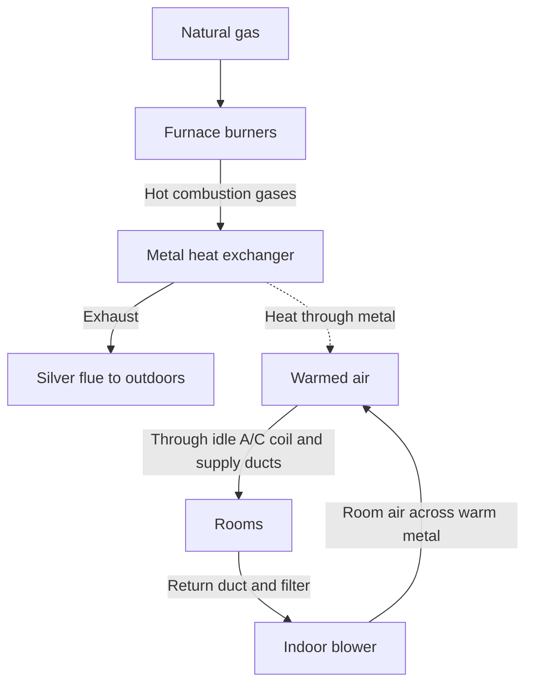
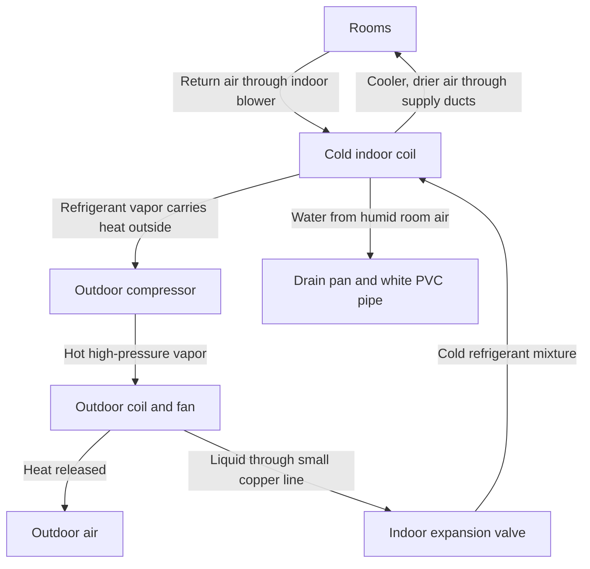
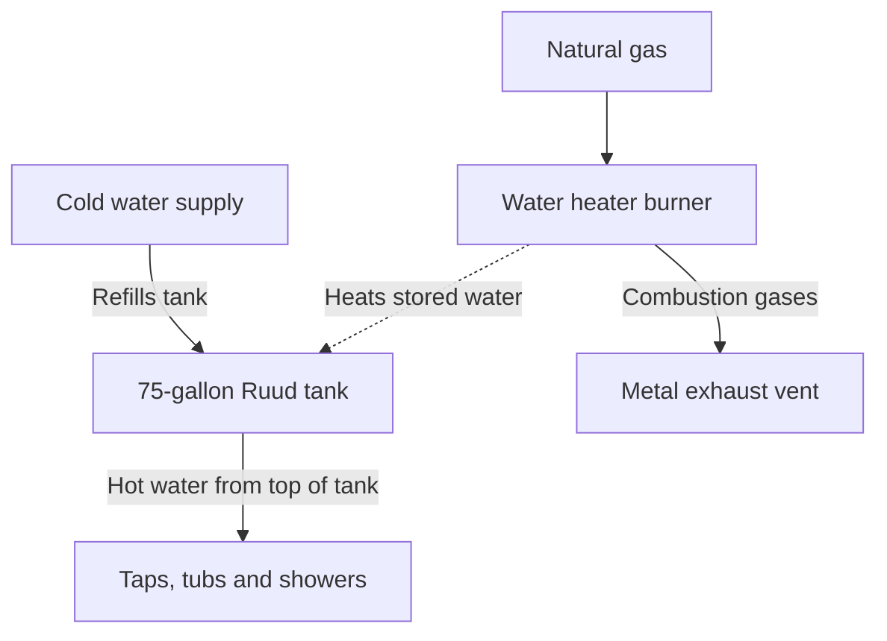

garage has **three functions that are easy to distinguish**. The **Ruud furnace** heats room air by burning natural gas. The **Carrier A/C** cools room air by moving heat outdoors. They share the **same indoor blower and ducts**. The **Ruud water heater** has its own burner and sends hot water through plumbing to your taps and showers.

[Home_Heating_Cooling_and_Hot_Water.md](https://chatgpt.com/library?file_id=libfile_62f4ddb884dc8191866fd4b2ed933145&account_id=personal)

| Equipment | Model | Manufactured | What you have |
|---|---|---|---|
| Ruud gas furnace | `R801T0754A17UHSNAS` | June 2023 | Single-stage natural-gas heat. Rated 75,000 BTU/hr input and 60,000 BTU/hr heat output, with 80% AFUE. [www.rheem.com](https://www.rheem.com/product/rheem-r801t-uh-endeavor-line-classic-series-gas-furnace-r801t0754a17uhsnas/?utm_source=chatgpt.com) |
| Carrier indoor coil | `CNPVP3617ALAAAAA` | July 2017 | The box above the furnace. It contains the cooling coil and the valve that meters R-410A refrigerant. |
| Carrier outdoor A/C with readable label | `24ACC436A300` | August 2017 | A cooling-only unit with 3 tons of nominal capacity, equivalent to 36,000 BTU/hr. [www.peirce.com](https://www.peirce.com/carrier-comfort-3-ton-14-seer-residential-air-conditioner-condensing-unit--b48637a?utm_source=chatgpt.com) |
| Ruud gas water heater | `PRO+G75-76N RU` | June 10, 2015 | The round 75-gallon tank. Its label gives 75,100 BTU/hr of natural-gas input and 80% thermal efficiency. |

### 1. Winter heating — the furnace adds heat to room air

When the wall thermostat calls for heat, a small **inducer fan** establishes draft through the furnace. A **direct spark** lights the burners. Once the metal heat exchanger warms up, the larger **indoor blower** pushes household air across its outer surface. That separation matters: **room air picks up heat through the metal, while combustion gases leave through the silver flue**. The outdoor A/C stays off. [Ruud Gas Furnaces](https://www.ruud.com/product/r801t-uh-endeavor-line-achiever-series-gas-furnace/?utm_source=chatgpt.com)

### 2. Summer cooling — the A/C moves heat outdoors

The **same indoor blower** now pushes room air across the cold Carrier coil above the furnace. Refrigerant inside the coil absorbs heat. Moisture from the air condenses on the outside of the coil and drains through the white pipe. The furnace burner stays off.

One correction to your draft: the **compressor raises the pressure of refrigerant vapor**. The **outdoor coil** is where that vapor releases heat and turns into liquid. This is why you can feel warm air above the outdoor fan while cool air comes from your room vents. [Carrier AC Guide](https://www.carrier.com/us/en/residential/hvac-resources/air-conditioners/how-do-air-conditioners-work/?utm_source=chatgpt.com)

### 3. Domestic hot water — the tank heats water for taps

When you open a hot tap, hot water leaves the top of the tank and cold water enters to replace it. The **tank’s own temperature control** turns its burner on when the stored water cools. That’s why you have hot showers in summer even when the wall thermostat is set to **Cool**.

