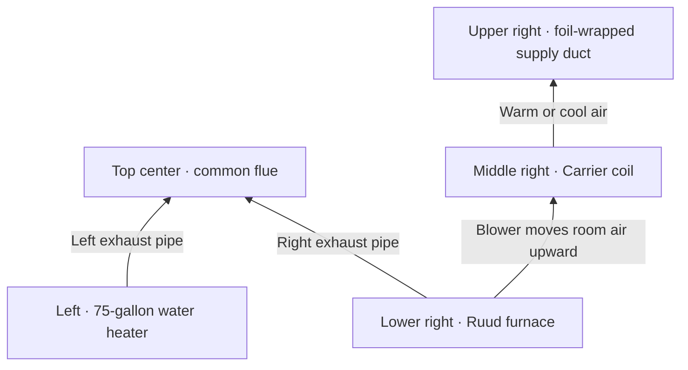
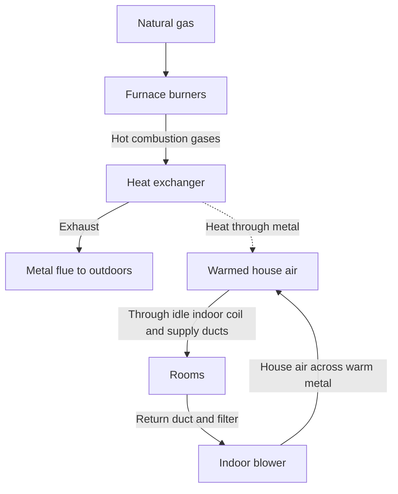
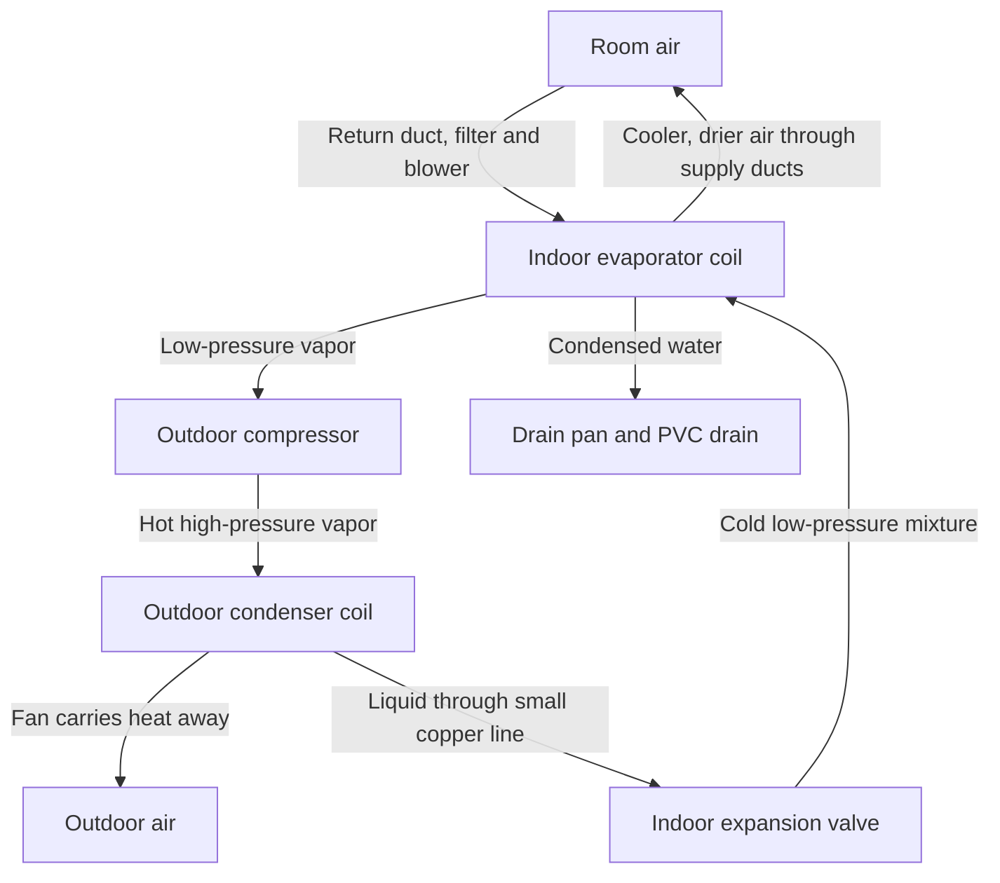
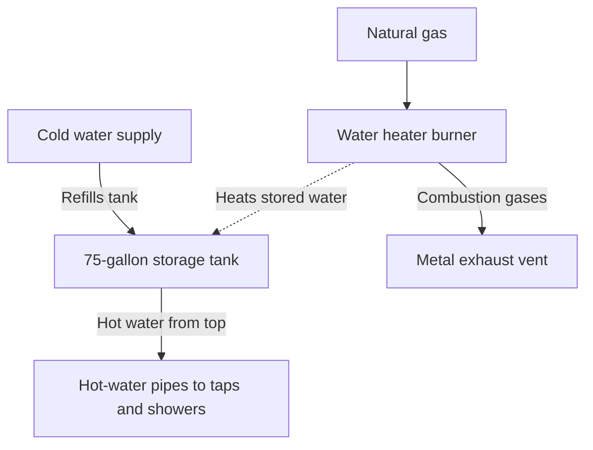

# Your home heating, cooling, and hot water

In the garage photo, the **rectangular Ruud cabinet** heats the air, the **Carrier box stacked above it** cools the air, and the **round Ruud tank** heats water. The furnace and A/C share an indoor fan and ducts. The tank has its own burner, temperature control, and water pipes.

## Quick view of your equipment

| Job | Equipment and model | Manufactured | What the rating means |
|---|---|---|---|
| Heat the rooms | Ruud natural-gas furnace `R801T0754A17UHSNAS` | June 2023 | Single-stage burner. At its rated firing level it takes in 75,000 BTU/hr of gas and supplies 60,000 BTU/hr of heat. Its annual fuel utilization efficiency (AFUE) is 80%. |
| Cool and dry indoor air | Carrier evaporator coil `CNPVP3617ALAAAAA` | July 2017 | The coil above the furnace uses R-410A refrigerant. A factory-installed thermostatic expansion valve (TXV) meters refrigerant entering the coil. |
| Release heat outdoors | Carrier A/C `24ACC436A300`, product `24ACC436A0030011` | August 2017 | Single-stage, cooling-only unit. Its nominal 3-ton rating means it can remove about 36,000 BTU of heat per hour at rated conditions. |
| Heat water for taps | Ruud gas storage water heater `PRO+G75-76N RU` | June 10, 2015 | Stores 75 US gallons. The label gives 75,100 BTU/hr of natural-gas input and 80% thermal efficiency. |

The dates are factory dates. The 2023 furnace and the 2017 coil above it are distinct pieces of equipment and can be replaced at different times. Your outdoor photo shows **two Carrier units**. Only one outdoor label is documented. The cooling diagram shows how this type of split system works. The photos do not establish which outdoor unit connects to the garage or which rooms each system serves.

## Garage photo map

Start at the ceiling, then read the photo from left to right. The **round silver pipes overhead carry exhaust**. The **large foil-wrapped box on the right carries air to the rooms**. [Open the garage photo (RUDD_Big.jpeg)](https://chatgpt.com/library?file_id=libfile_b0bf8578a430819180d542bce47180ad&account_id=personal)

| Where to look | What you can recognize | What it connects to or carries |
|---|---|---|
| **Top center, at the ceiling** | Two round galvanized pipes meet below the ceiling opening. | The left branch comes from the water heater and the right branch from the furnace. Their common flue carries combustion gases outdoors. Only the run up to the ceiling is visible. |
| **Far left** | Round gray Ruud Achiever tank with Virginia Tech and UVA decals. | Stores 75 gallons of hot water for household fixtures. Its own burner heats the tank. |
| **On top of the tank** | Two black-insulated water connections flank the round exhaust pipe. | One admits cold water and the other supplies hot water to the house. The photo does not distinguish inlet from outlet. |
| **Right edge of the tank** | A bare vertical copper pipe descends from a side fitting with a yellow tag. | This appears to be the discharge line for the temperature-and-pressure relief valve. It provides an outlet if the valve opens. |
| **Top right, above the coil** | Large rectangular box wrapped in silver foil insulation. | This supply plenum collects air from the equipment stack and feeds the supply ducts in both seasons. |
| **Middle right, below the foil wrap** | Gray Carrier coil cabinet with two copper refrigerant connections. | In cooling mode, the smaller copper line brings liquid R-410A indoors. The larger diagonal line in black foam carries refrigerant vapor back outdoors. |
| **At the lower edge of the coil cabinet** | White PVC fittings and the RectorSeal trap beside the insulated lines. | Water that condenses on the cold coil collects in a pan and leaves through this drain. |
| **Lower right** | Rectangular Ruud furnace cabinet with a yellow flexible gas line entering its side. | The yellow line feeds the burners. Inside the lower cabinet, the blower pushes return air upward through the furnace and coil. The blower and filter are out of view. |

## Winter heating · Follow the air and the flame separately

1. **The thermostat calls for heat.** If the room is 65°F and you ask for 68°F, the furnace control starts the **inducer**, a small fan that establishes the draft for combustion. After the control verifies draft, it opens the gas valve and uses a **direct spark** to light the burners. A sensor confirms the flame.
2. **The furnace warms the air.** Hot combustion gases pass inside the heat exchanger. After a short delay, the larger **indoor blower** pushes filtered room air across the outside of that metal. The metal transfers heat while keeping exhaust and room air separate.
3. **Warm air goes back to the rooms.** Air passes upward through the idle Carrier coil and into the foil-wrapped supply duct. The cooling-only outdoor unit stays off. When the thermostat is satisfied, the gas valve closes. With the fan set to Auto, the blower runs briefly to deliver remaining heat, then stops.

## Summer cooling · Follow the heat from indoors to outdoors

1. **The thermostat calls for cooling.** The indoor blower and outdoor A/C operate. The furnace burner stays off. The blower pushes warm room air across the cold coil above the furnace. Refrigerant inside absorbs heat and evaporates. Moisture from the room air collects on the outside of the coil and drips into the pan.
2. **The outdoor unit releases the heat.** Refrigerant vapor returns through the **larger insulated copper line**. The compressor raises the vapor’s pressure and temperature. Inside the outdoor coil, the refrigerant releases heat and condenses into liquid as the top fan moves outdoor air across the coil.
3. **Refrigerant returns indoors.** The smaller copper line carries high-pressure liquid to the TXV. The valve meters the flow and drops the pressure. A cold mixture of liquid and vapor enters the indoor coil and can absorb more heat. Indoor air circulates through the ducts while refrigerant circulates through the copper lines.

## Domestic hot water · Follow the water to a tap

Opening a hot tap draws heated water from the top of the tank. Cold water enters to replace it. When the stored water cools below the tank control’s setting, its own burner reheats it. The wall thermostat can be off while the tank is heating. In the wide garage photo, the furnace and tank exhaust pipes join above the appliances. The water piping and household air ducts serve separate purposes.

## Property summary

 For the documented garage system, enter **natural gas** for heating fuel, **forced-air furnace** for heating type, and **central split-system A/C** for cooling. The furnace uses electricity for its blower, ignition, and controls. Door and window draftiness cannot be determined from equipment labels. A blower-door test measures whole-house air leakage at a specified pressure. An energy assessor can locate individual leaks during the test.

**Equipment references.** Models and manufacture dates come from your photographs. [Ruud furnace and ignition specifications](https://www.ruud.com/product/r801t-uh-endeavor-line-achiever-series-gas-furnace/) · [Furnace capacity for the photographed model](https://www.rheem.com/product/rheem-r801t-uh-endeavor-line-classic-series-gas-furnace-r801t0754a17uhsnas/) · [Carrier 24ACC4 product data](https://resource.carrierenterprise.com/is/content/Watscocom/carrier_24acc430a003_article_1429461218622_en_ss) · [Carrier explanation of the cooling cycle](https://www.carrier.com/us/en/residential/hvac-resources/air-conditioners/how-do-air-conditioners-work/)
