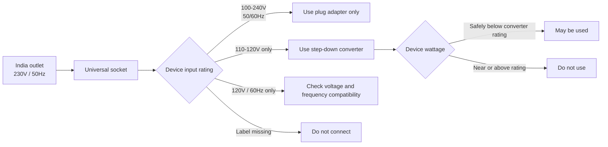
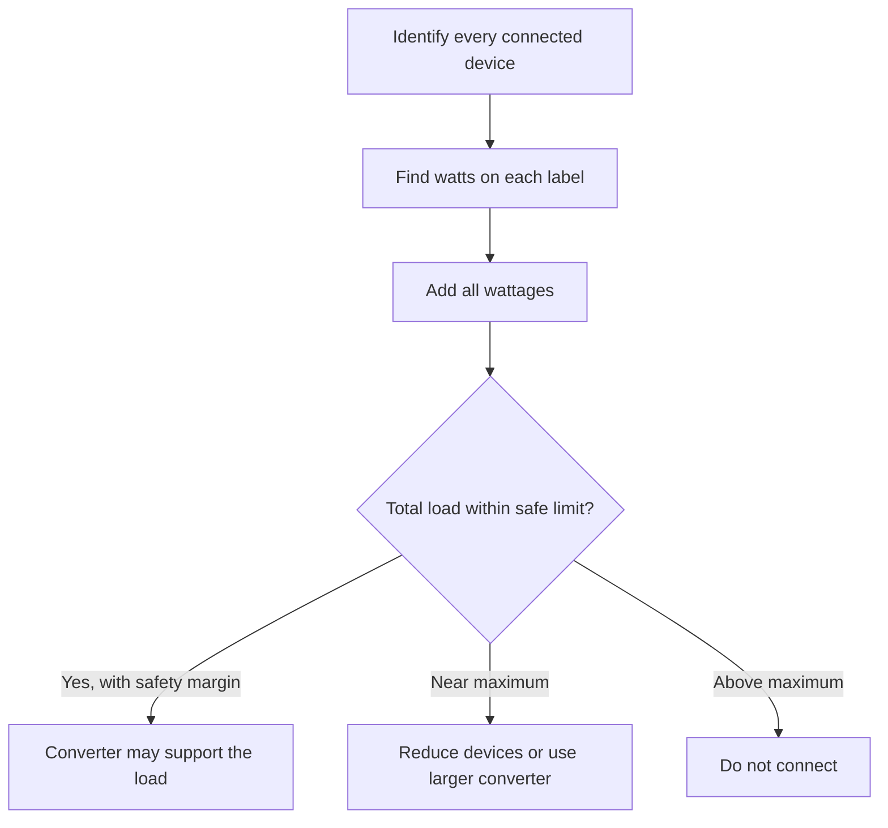
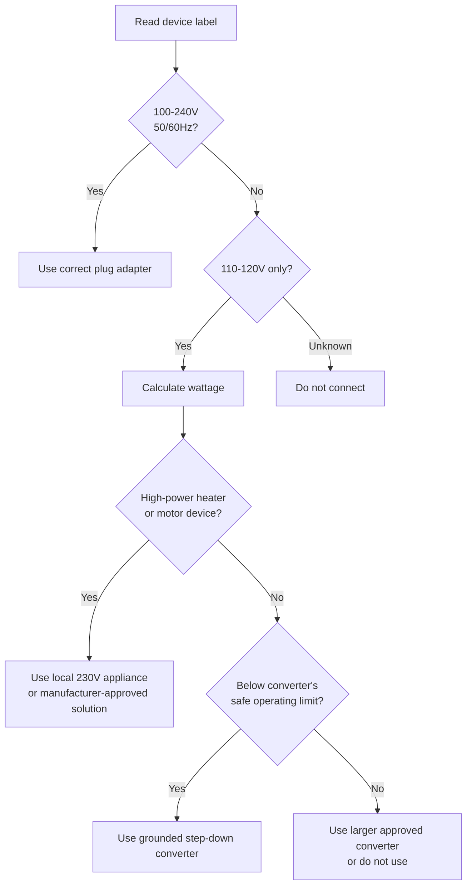

Here is a compact version focused on the decision process and the equipment needed for each use case.

# Using U.S. Electrical Devices in India

## Key Points

* A U.S. plug may physically fit an Indian outlet, but that does **not** mean the voltage is compatible.
* Typical U.S. supply: **120V, 60Hz**
* Typical Indian supply: **230V, 50Hz**
* A plug adapter changes only the **plug shape**.
* A step-down converter changes approximately **230V to 120V**.
* Connecting a 120V-only device directly to 230V can cause overheating, fuse failure, fire risk, or permanent damage.
* Devices marked `100–240V, 50/60Hz` usually need only a suitable plug adapter.
* Devices marked `110–120V only` require a properly sized step-down converter.
* High-power heating appliances generally require very large converters and are usually better left at home.

## Why the Device Can Burn Out

For a resistive appliance, power is approximately:

[
P = \frac{V^2}{R}
]

Supplying 230V to a device designed for 120V can produce approximately:

[
\left(\frac{230}{120}\right)^2 \approx 3.7
]

The device may therefore experience nearly **3.7 times its intended heating power**.



## Check the Device Label

| Device label        | What is needed in India                                 |
| ------------------- | ------------------------------------------------------- |
| `100–240V, 50/60Hz` | Plug adapter only                                       |
| `110–120V, 50/60Hz` | 230V-to-120V step-down converter                        |
| `120V, 60Hz only`   | Step-down converter plus frequency compatibility review |
| No readable label   | Do not connect until verified                           |

## What Is Needed to Cover the Main Use Cases

### Use Case 1: Phones, Laptops and USB Electronics

**Typical label**

```text
INPUT: 100–240V, 50/60Hz
```

**Needed**

* Original manufacturer charger
* Proper India Type C, D, or M plug adapter
* Surge protection where electrical quality is uncertain

**Voltage converter:** Not normally required.

---

### Use Case 2: Small 120V-Only Electronics

Examples:

* Electric toothbrush charger
* Electric shaver
* Small battery charger
* Low-power electronic device

**Needed**

* 230V-to-120V step-down converter
* Converter wattage safely above the device wattage
* Correct India input plug
* Proper grounding where required

A reasonable operating target for a converter rated at 250W is approximately **200W or less**, rather than continuously operating at its maximum rating.

---

### Use Case 3: Hair Straighteners and Curling Irons

These may work only when:

* The device is not already dual-voltage.
* Its wattage is below the converter limit.
* The manufacturer permits converter use.
* The converter can handle startup current and continuous heating.

**Needed**

* Wattage verification
* Step-down converter with safety margin
* Heat-resistant placement and proper ventilation

A dual-voltage travel model is usually the simpler option.

---

### Use Case 4: Hair Dryers, Irons, Kettles and Heaters

These commonly consume between several hundred and more than 1,500 watts.

**Needed**

* A high-capacity transformer specifically designed for the appliance
* Proper grounding
* Heavy-duty wiring and plug connection
* Significant wattage safety margin

A 250W converter is **not suitable**.

It is normally safer and more practical to purchase or use a local 230V appliance.

---

### Use Case 5: CPAP and Medical Equipment

**Preferred solution**

* Manufacturer-provided `100–240V, 50/60Hz` power supply
* Manufacturer-approved travel power supply
* Correct grounded plug adapter
* Battery backup where medically necessary

Avoid relying on an unverified general-purpose converter for critical medical equipment.

---

### Use Case 6: Motors, Pumps, Clocks and Compressors

These devices can be sensitive to the difference between:

* U.S.: 60Hz
* India: 50Hz

A voltage converter may reduce voltage without properly correcting frequency.

**Needed**

* Manufacturer confirmation of 50Hz compatibility
* Adequate startup-current capacity
* True frequency converter when required
* Appropriate output waveform for sensitive electronics

## Converter Sizing

Calculate device power using:

[
\text{Watts} = \text{Volts} \times \text{Amps}
]

Example:

```text
120V × 1.5A = 180W
```

A 180W device may fit within a 250W converter rating, although additional safety margin is recommended.

Another example:

```text
Hair dryer = 1500W
Converter limit = 250W
```

The hair dryer is approximately six times over the converter limit and must not be connected.

## Multiple Devices

The converter rating applies to the **combined load**, not separately to each outlet.

```text
Device 1: 100W
Device 2: 80W
Device 3: 90W
Total:    270W
```

A combined 270W load exceeds a 250W converter rating.



## Plug and Grounding Requirements

India commonly uses Type C, D, and M outlets.

To safely cover different homes and hotels, consider:

* A properly certified Type D adapter
* A properly certified Type M adapter for larger outlets
* A Type C adapter for compatible two-pin outlets
* A grounded adapter for three-prong U.S. devices
* A voltage tester or outlet tester
* Avoiding loose stacks of multiple adapters

A three-hole outlet does not guarantee that grounding is correctly connected.

## Recommended Travel Kit

To cover most normal travel use cases:

1. Universal plug adapter supporting India Type C, D, and M
2. Original dual-voltage phone and laptop chargers
3. USB charger marked `100–240V, 50/60Hz`
4. Small step-down converter for verified 120V-only devices below its safe wattage
5. Grounded adapter for grounded appliances
6. Surge protector compatible with 230V power
7. Photos of each device’s electrical label
8. Local 230V appliances for high-power heating devices

## Final Decision Rule



## Bottom Line

The linked 250W step-down converter can cover **small, verified 120V-only devices**, provided their combined wattage remains comfortably below the limit.

It does not adequately cover:

* Hair dryers
* Clothes irons
* Kettles
* Space heaters
* Coffee makers with heating elements
* Large kitchen appliances
* Devices with uncertain frequency requirements
* Critical medical devices without manufacturer approval

For devices marked `100–240V, 50/60Hz`, use the original power supply and the correct India plug adapter—no voltage converter is needed.

This can also be reduced into a one-page travel checklist or device-by-device compatibility table.
